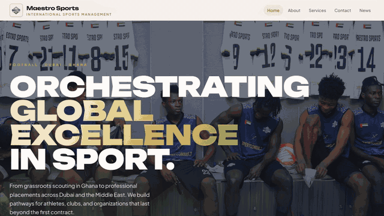
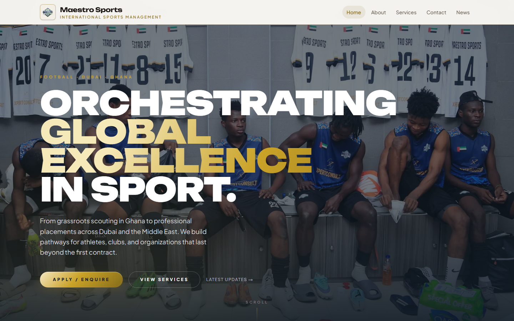
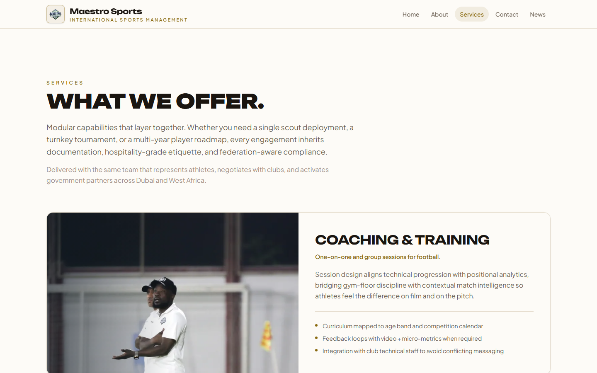
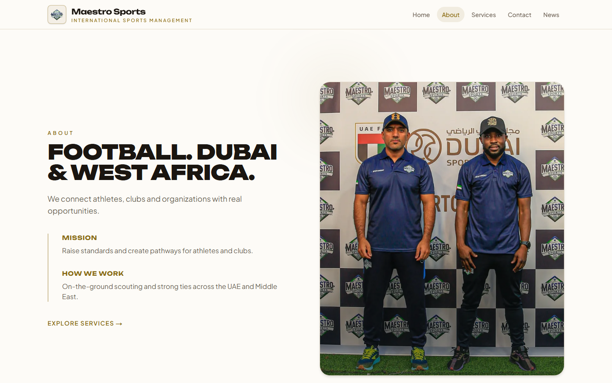
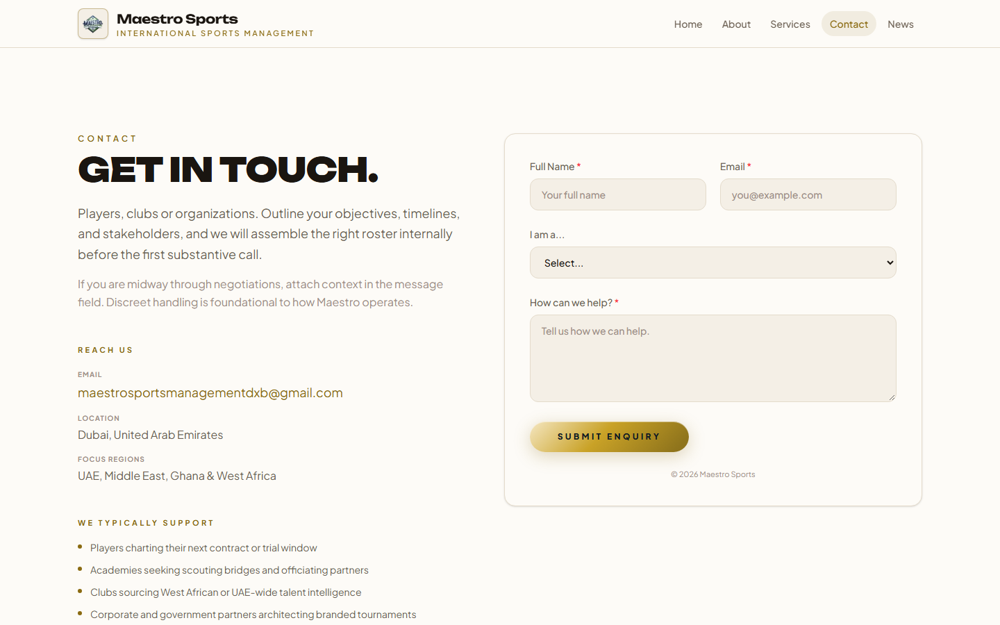
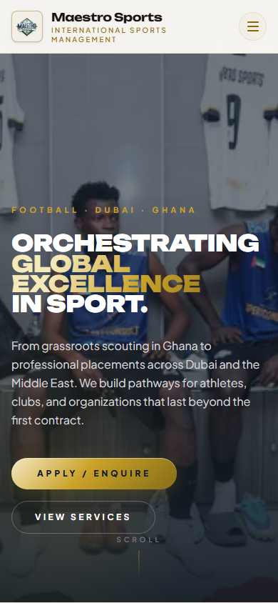
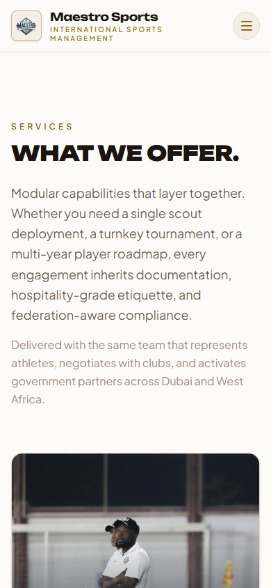
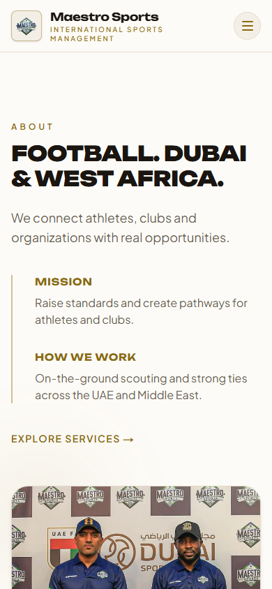
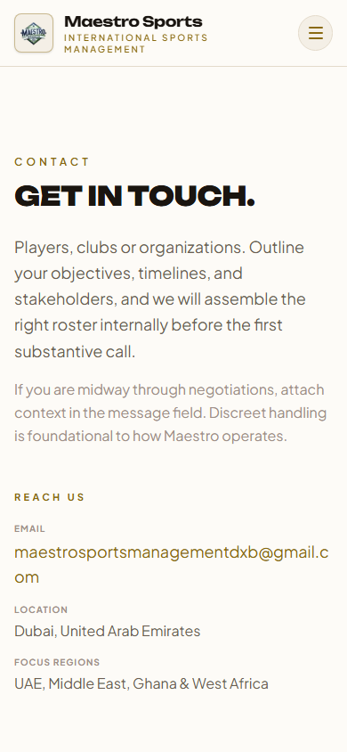
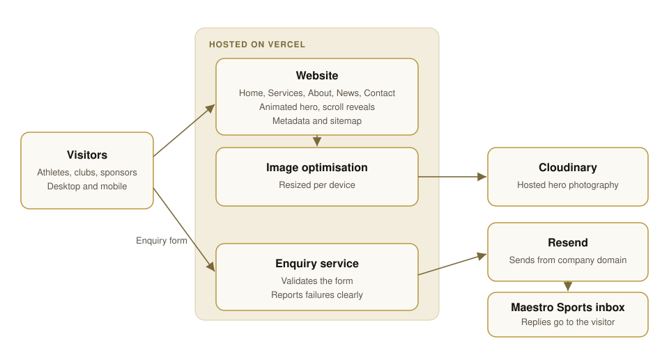

# Maestro Sports

**The website of an international football management company, connecting talent in Ghana and West Africa with opportunities in Dubai and the Middle East.**

[Live site](https://maestrosportsmanagement.com) · [Demo video](https://github.com/7kbytes/maestrosports-showcase/releases/download/v1.0/maestro-demo.webm) · [How it works](#how-it-works) · [Contact](#contact)

> This is a product showcase. The source code is private, and nothing here is open for reuse. See [All Rights Reserved](#all-rights-reserved).

## The problem

Talented players in West Africa can struggle to reach clubs abroad. Scouting is often inconsistent, and players and families need clear support around trials and contracts. Clubs and sponsors, meanwhile, need a credible partner they can check before they get in touch.

## The solution

Maestro Sports works from Dubai, with scouting roots in Ghana and West Africa. Its website presents that work in one place and gives each audience a direct route to the team through a short enquiry form.

## Features

| For athletes and families | For clubs and partners | Under the hood |
| --- | --- | --- |
| Coaching and player development services | Scouting and officiating services | Animated 3D hero and smooth scrolling |
| Enquiry form with role selection | Corporate tournament services | Optimised images |
| News and articles | Track record and regional presence | Search metadata and sitemap |
| Mobile-friendly pages | Direct email contact | Optional, consent-based analytics |

## Screenshots

| Home | Services |
| --- | --- |
|  |  |

| About | Contact |
| --- | --- |
|  |  |

| Mobile home | Mobile services | Mobile about | Mobile contact |
| --- | --- | --- | --- |
|  |  |  |  |

Captured from the live website on 31 October 2026, on desktop and at phone width.

## How it works

## Tech stack

| Area | Technology |
| --- | --- |
| Web | Next.js, React, TypeScript, Tailwind CSS |
| 3D and motion | React Three Fiber, Three.js, GSAP, Framer Motion, Lenis |
| Enquiry email | Resend |
| Images | Cloudinary |
| Analytics | Google Analytics, with consent |
| Hosting | Vercel |

## The market

Maestro Sports serves football players, academies, clubs, corporate sponsors and government partners. Its corridor runs from Ghana and West Africa to the UAE and the wider Middle East. Its services are coaching, player development, officiating, scouting and corporate tournaments.

## Traction

- The website is live at [maestrosportsmanagement.com](https://maestrosportsmanagement.com).
- User and revenue numbers are not published yet.

## Try it

- **Live site:** [maestrosportsmanagement.com](https://maestrosportsmanagement.com)
- **Android APK:** not applicable, as this is a website
- **Pitch deck:** available on request by email

## Contact

- **Email:** [maestrosportsmanagementdxb@gmail.com](mailto:maestrosportsmanagementdxb@gmail.com)
- **GitHub:** [@7kbytes](https://github.com/7kbytes)

## All Rights Reserved

© 2026 7Kbytes. All Rights Reserved. Nothing in this repository may be copied, modified, distributed or reused without prior written permission. See [LICENSE](LICENSE).
